<p align="right">
  <a href="README.md"></a>
  <a href="README.pl.md"></a>
</p>

<a href="#see-it-in-action">
  <picture>
    <source media="(prefers-color-scheme: dark)" srcset="docs/banner-dark.svg" />
    <source media="(prefers-color-scheme: light)" srcset="docs/banner-light.svg" />
    
  </picture>
</a>

<p align="center">
  <a href="https://github.com/Nurek54/SymptomChecker/actions/workflows/ci.yml"></a>
  
  
  
  
  
  
  
  
  
  
  
</p>

<p align="center">
  <a href="#see-it-in-action"><b>Demo</b></a> &nbsp;·&nbsp;
  <a href="#highlights"><b>Highlights</b></a> &nbsp;·&nbsp;
  <a href="#screenshots"><b>Screenshots</b></a> &nbsp;·&nbsp;
  <a href="#how-it-works"><b>How it works</b></a> &nbsp;·&nbsp;
  <a href="#getting-started"><b>Getting started</b></a> &nbsp;·&nbsp;
  <a href="#api-endpoints"><b>API</b></a>
</p>

> [!WARNING]
> **Educational / research project, not a medical device.** The output is not a diagnosis. If symptoms worsen or red flags appear, contact a doctor or emergency services (112).

**Symptom Checker** is a diagnostic chat assistant built as part of an engineering thesis (*praca inżynierska*). You describe how you feel in plain Polish; the app recognizes the symptoms (inflection and negation included, e.g. *"gorączki nie mam"*), asks the follow-up questions that best separate the likely diseases, and returns the **Top-3 most probable conditions** with a short, doctor-style explanation from a Polish LLM running on your own GPU.

Predictions come from a **calibrated ensemble** of XGBoost (Bayesian-tuned on GPU) and a River one-vs-rest logistic model (trained in mini-batches, then keeps learning online), averaged with a weight fitted on held-out data. The ensemble is statistically significantly more accurate than either model alone.

<p align="center"><b>Keywords</b></p>

<table align="center">
  <tr>
    <td align="right" valign="middle"><sub><b>AI&nbsp;/&nbsp;ML</b></sub></td>
    <td>
      
      
      
      
      
      
      
      
    </td>
  </tr>
  <tr>
    <td align="right" valign="middle"><sub><b>LLM&nbsp;/&nbsp;NLP</b></sub></td>
    <td>
      
      
      
      
      
      
    </td>
  </tr>
  <tr>
    <td align="right" valign="middle"><sub><b>Methods</b></sub></td>
    <td>
      
      
      
      
      
      
      
    </td>
  </tr>
  <tr>
    <td align="right" valign="middle"><sub><b>Domain</b></sub></td>
    <td>
      
      
      
    </td>
  </tr>
  <tr>
    <td align="right" valign="middle"><sub><b>Backend</b></sub></td>
    <td>
      
      
      
      
      
    </td>
  </tr>
  <tr>
    <td align="right" valign="middle"><sub><b>Frontend</b></sub></td>
    <td>
      
      
      
      
    </td>
  </tr>
  <tr>
    <td align="right" valign="middle"><sub><b>Testing&nbsp;/&nbsp;CI</b></sub></td>
    <td>
      
      
      
      
    </td>
  </tr>
</table>

## See it in action

<p align="center">
  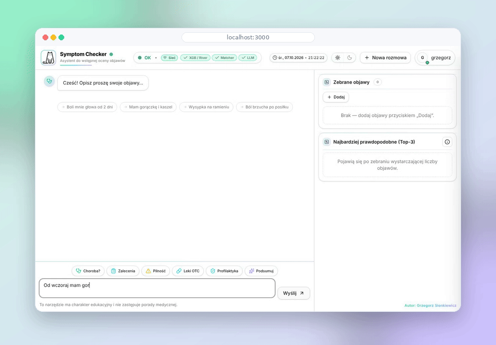
</p>

<p align="center"><sub>First message → follow-up questions → Top-3 with explanation → quick action <em>Pilność</em> → XGBoost / River / Ensemble breakdown.</sub></p>

## Highlights

<table>
  <tr>
    <td width="33%" valign="top">
      <br />
      <b>Understands Polish</b><br />
      <sub>Curated PL dictionary with synonyms, a light Polish stemmer and fuzzy matching; handles inflection (<i>boli mnie głowa</i>) and negation (<i>gorączka już minęła</i>).</sub>
    </td>
    <td width="33%" valign="top">
      <br />
      <b>Asks the right question</b><br />
      <sub>Picks the symptom that best separates the likely diseases, learns from your “no” answers too and stops as soon as the model is confident (at most 5 questions).</sub>
    </td>
    <td width="33%" valign="top">
      <br />
      <b>Calibrated ensemble</b><br />
      <sub>XGBoost and River are each temperature-calibrated on held-out data; their weight in the average is fitted there too. The ensemble beats both models (McNemar p = 0.002).</sub>
    </td>
  </tr>
  <tr>
    <td width="33%" valign="top">
      <br />
      <b>Local LLM</b><br />
      <sub>Bielik 11B v2.3 (GGUF) via <code>ctransformers</code> writes the explanation in natural Polish prose. No external AI API.</sub>
    </td>
    <td width="33%" valign="top">
      <br />
      <b>Transparent</b><br />
      <sub>Per-model Top-3 and the fusion weights are one click away in the UI; full metrics land in <code>training_report.json</code>.</sub>
    </td>
    <td width="33%" valign="top">
      <br />
      <b>Quick actions</b><br />
      <sub>One click for diagnosis, recommendations, urgency, OTC medicines, prevention or a summary.</sub>
    </td>
  </tr>
  <tr>
    <td width="33%" valign="top">
      <br />
      <b>Accounts or guest mode</b><br />
      <sub>Supabase auth with saved history, or start chatting right away as a guest.</sub>
    </td>
    <td width="33%" valign="top">
      <br />
      <b>Training with ETA</b><br />
      <sub>Every long step logs elapsed and remaining time; startup is split into 5 timed stages.</sub>
    </td>
    <td width="33%" valign="top">
      <br />
      <b>Tested</b><br />
      <sub>pytest (unit, API, regressions), vitest and Playwright end-to-end; leak-free train / calibration / test split.</sub>
    </td>
  </tr>
</table>

## Screenshots

<p align="center">
  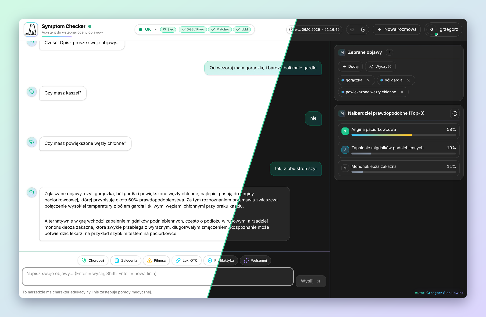
</p>

<table>
  <tr>
    <td width="50%" valign="top">
      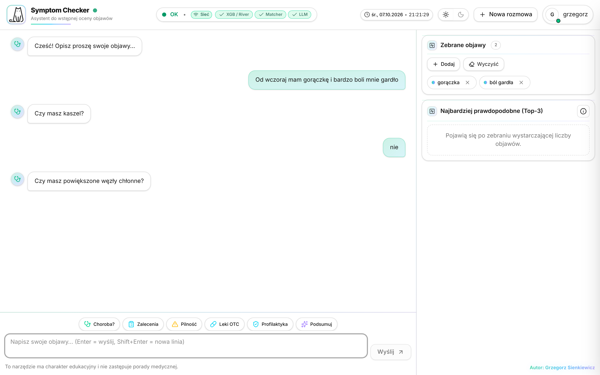
      <p align="center"><b>Adaptive follow-up questions</b><br /><sub>Recognized symptoms appear on the right as you type.</sub></p>
    </td>
    <td width="50%" valign="top">
      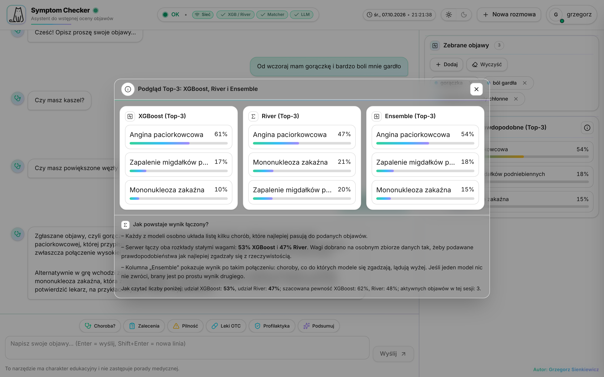
      <p align="center"><b>Look inside the ensemble</b><br /><sub>XGBoost, River and the fused result side by side, with the weights used.</sub></p>
    </td>
  </tr>
  <tr>
    <td width="50%" valign="top">
      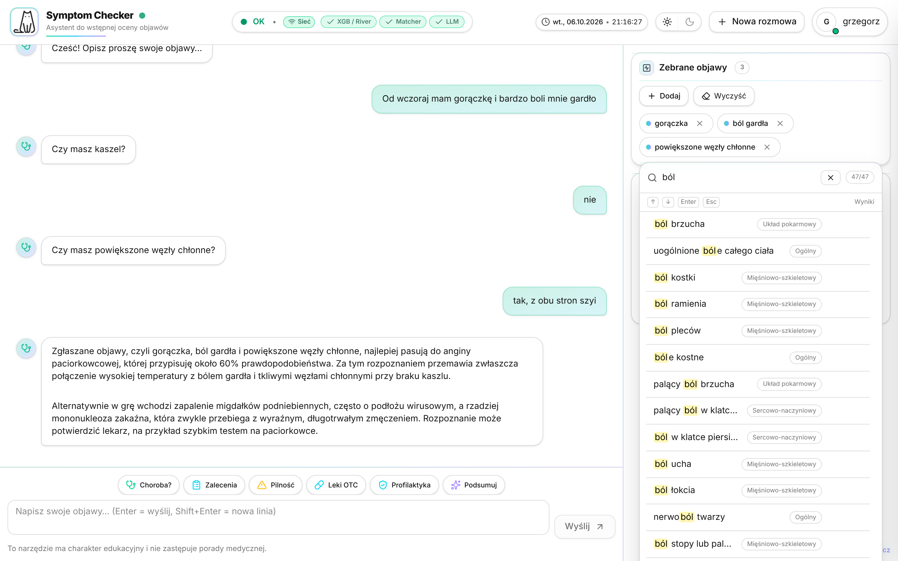
      <p align="center"><b>Symptom picker</b><br /><sub>Hundreds of Polish symptom names grouped by body system.</sub></p>
    </td>
    <td width="50%" valign="top">
      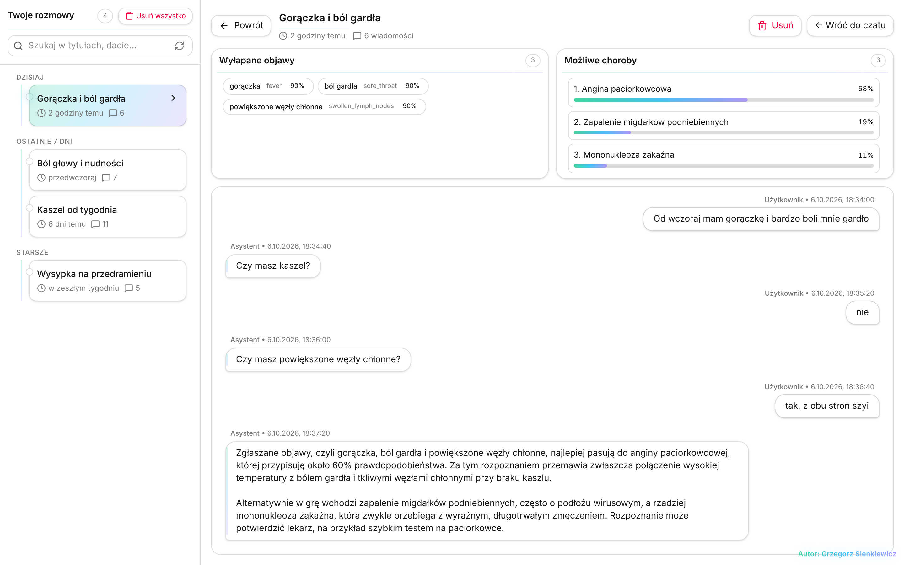
      <p align="center"><b>Conversation history</b><br /><sub>Saved chats with extracted symptoms and the diagnoses at that time.</sub></p>
    </td>
  </tr>
</table>

<details>
<summary><b>More screens</b> (visit preparation, help, account, login)</summary>
<br />

| Prepare a description for the doctor | Built-in guide |
|:---:|:---:|
| 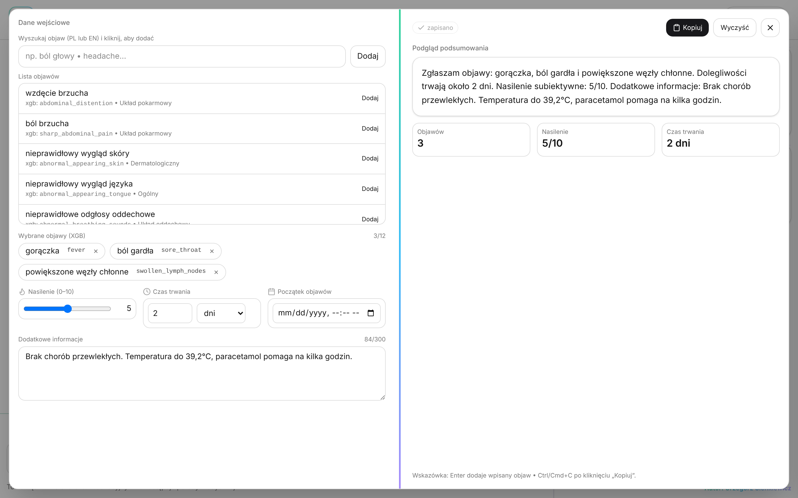 | 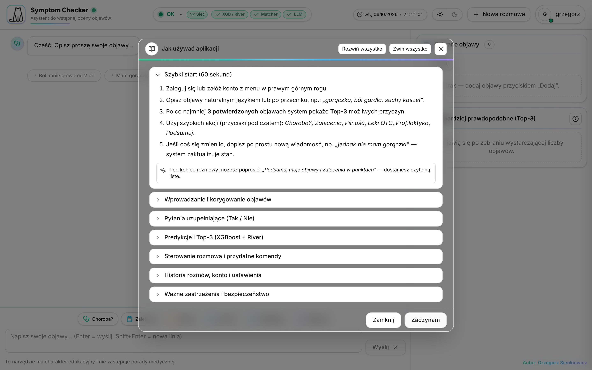 |
| **Account menu** | **Login or guest mode** |
| 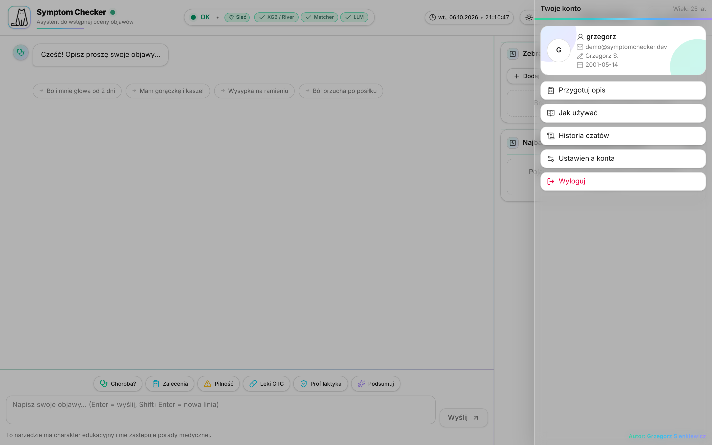 | 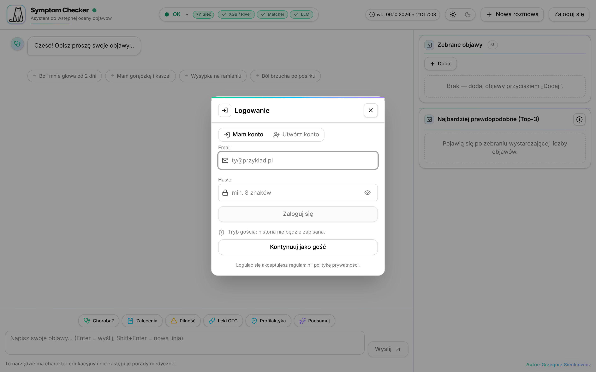 |

</details>

<sub>Screenshots and the demo come from the real frontend; the backend responses in them are scripted so the example is reproducible.</sub>

## How it works

<picture>
  <source media="(prefers-color-scheme: dark)" srcset="docs/ensemble-dark.svg" />
  <source media="(prefers-color-scheme: light)" srcset="docs/ensemble-light.svg" />
  
</picture>

### One chat turn

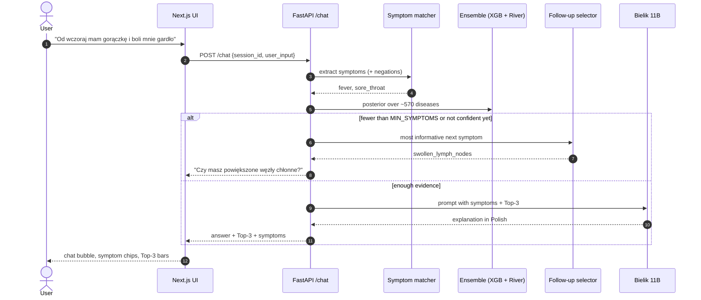

### Architecture

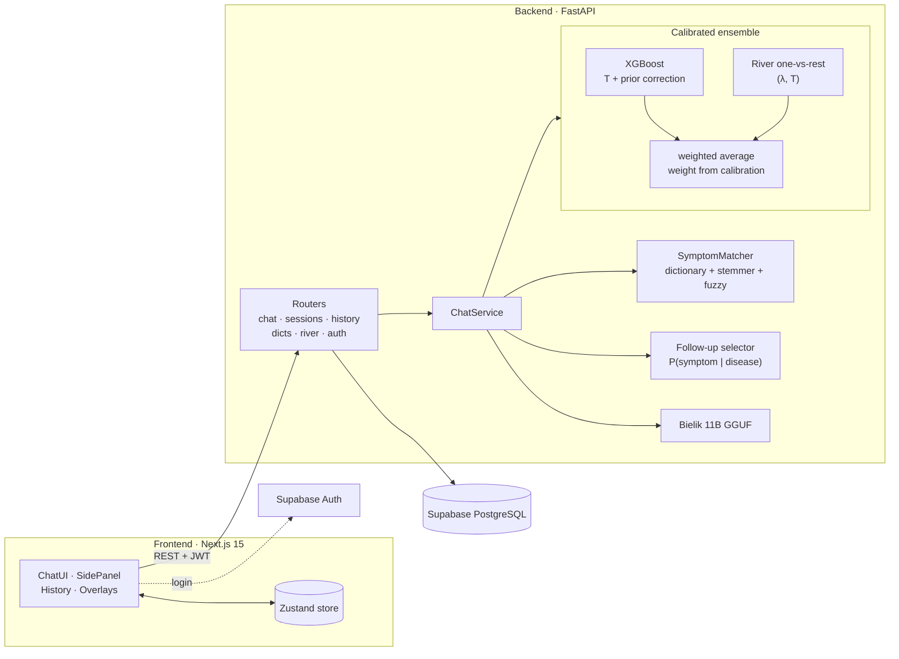

### Training pipeline (first start)

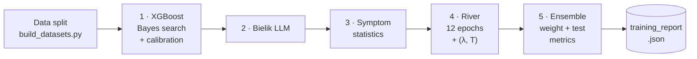

Every stage logs elapsed and remaining time, so a long first run is never a black box ([more](#progress-and-remaining-time)):

<p align="center">
  
</p>

### Results

<picture>
  <source media="(prefers-color-scheme: dark)" srcset="docs/results-dark.svg" />
  <source media="(prefers-color-scheme: light)" srcset="docs/results-light.svg" />
  
</picture>

Held-out test set: **24,278 cases, 569 diseases**, no symptom vector shared with the training or calibration data. Numbers come from `backend/ml_validation_runner.py` (report in `backend/reports/ml_validation/`).

| Model | Top-1 | Top-3 | NLL | ECE | Brier |
|---|:---:|:---:|:---:|:---:|:---:|
| XGBoost | 90.7% | 98.5% | 0.235 | 2.0% | 0.122 |
| River | 90.6% | 98.4% | 0.242 | 1.8% | 0.124 |
| **Ensemble** | **91.0%** | **98.6%** | **0.217** | **1.3%** | **0.113** |

- The right disease is among the three shown in **98.6%** of cases.
- The ensemble is better than both models on every metric. On Top-1 it fixes 369 cases XGBoost gets wrong and breaks 288 (exact McNemar test, **p = 0.002**).
- Calibration matters: River's raw one-vs-rest scores said about 75% when it was right 91% of the time (ECE 15.7% on the calibration set); after calibration ECE is 1.8% on the test set.

<details>
<summary><b>Validation criteria</b> (result: <b>passed</b>)</summary>
<br />

`python ml_validation_runner.py` checks the ensemble against the better of the two models on the same test cases:

| Criterion | Requirement | Result |
|---|---|:---:|
| K1 | Top-1 significantly better (exact McNemar, p < 0.05) | ✓ p = 0.0018 |
| K2 | Top-3 significantly better (exact McNemar, p < 0.05) | ✗ p = 0.14 |
| K3 | No more errors than either model | ✓ |
| K4 | ECE not worse than the worse model | ✓ 1.3% |
| No regression | No class loses >10 p.p. significantly (per-class McNemar, Holm correction) | ✓ 0 classes |

Passed = at least 2 of K1 to K3 and no regression. K1/K2 originally required non-overlapping 95% bootstrap intervals and the per-class check had no significance test; both were replaced by paired tests because the models are evaluated on the same cases (the old values are still printed for reference).

</details>

<sub>NLL = negative log-likelihood, ECE = expected calibration error (10 bins), Brier = multi-class Brier score. Lower is better.</sub>

## Tech Stack

| Layer | Technology |
|-------|-----------|
| Backend | Python 3.11+, FastAPI, Pydantic v2, SQLAlchemy 2.x |
| Frontend | Next.js 15 (App Router), React 19, TypeScript, Tailwind CSS, Zustand |
| Classical ML | XGBoost (`hist`, CUDA), scikit-learn, scikit-optimize |
| Online learning | River 0.23 (OneVsRest LogisticRegression; mini-batch warm start, then online SGD) |
| LLM | Bielik 11B v2.3 Instruct (GGUF Q6_K) via `ctransformers` |
| GPU | PyTorch (CUDA device detection), CUDA for XGBoost training and LLM layer offload |
| Symptom matching | PL dictionary + synonyms, light Polish stemmer, fuzzy matching (rapidfuzz or difflib) |
| Auth | Supabase JWT (HS256; only `aud`/`role` = `authenticated`), backend session cookie, python-jose |
| Persistence | Supabase PostgreSQL via SQLAlchemy (psycopg 3) |
| Testing | pytest, pytest-asyncio, vitest, Playwright |

## Project Structure

```
SymptomChecker/
├── backend/
│   ├── api/routers/          # auth, chat, dicts, history, river, sessions, errors, health
│   ├── core/                 # startup, AppState
│   ├── data/                 # PL/EN dictionaries, small testset (large CSVs gitignored)
│   ├── ml/                   # river_ovr_ftrl.joblib (in repo); xgb_model.joblib (excluded)
│   ├── models/               # llm_manager, river_manager, xgb_manager
│   ├── reports/              # ML validation outputs (SVG, JSON)
│   ├── services/             # ensemble, prompt_builder, symptom_matcher, sessions, …
│   ├── tests/                # pytest
│   ├── tools/                # export_predictions.py, simulate_followups.py (follow-up questions benchmark)
│   ├── weights/bielik-gguf/  # ⬅ drop Bielik GGUF here (gitignored)
│   ├── config.py             # ALL ML / LLM / auth knobs
│   ├── app.py                # FastAPI factory
│   ├── main.py               # uvicorn entrypoint
│   ├── ml_validation_runner.py
│   └── requirements.txt
├── database/                 # SQLAlchemy: models, CRUD, security, db init
├── docs/                     # README images: animated SVGs, demo.gif, screenshots/, icons/
├── frontend/
│   ├── .env.example          # frontend environment (copy to .env.local)
│   ├── public/               # logo
│   └── src/
│       ├── app/              # Next.js App Router pages
│       ├── components/       # ChatUI, AuthSheet, SidePanel, …
│       ├── lib/              # api, supabaseClient, types
│       ├── store/            # Zustand store
│       └── tests/            # unit + e2e
├── .github/workflows/ci.yml  # CI: pytest, ESLint, vitest, tsc, next build
├── logs/
├── .env.example              # backend environment (copy to .env)
├── .gitignore
├── FUTURE_PLANS.md           # planned extensions (English version)
├── LICENSE
├── README.md
└── README.pl.md              # Polish README
```

## Getting Started

### Prerequisites

- **Python 3.11** or newer
- **Node.js 18.18+** and npm (required by Next.js 15)
- **CUDA-capable GPU** strongly recommended (for fast XGBoost training and LLM inference). CPU works but is significantly slower.
- **~20 GB free disk space** (LLM weights ~9.2 GB, Python environment with PyTorch, XGBoost model ~590 MB, datasets ~500 MB)
- **Supabase project** - required by the backend: Postgres for history (`DATABASE_URL`, pooled) and Auth (`SUPABASE_JWT_SECRET`). In the UI you can still chat as a guest without logging in

### Backend

```bash
# in the repository root
python -m venv .venv
.\.venv\Scripts\Activate.ps1      # Windows (PowerShell)
source .venv/bin/activate        # Linux / macOS

pip install -r backend/requirements.txt
cp .env.example .env             # Windows: Copy-Item .env.example .env
```

Fill in `.env` (repository root, loaded by `backend/main.py`): `DATABASE_URL` (Supabase pooled Postgres URL), `SUPABASE_URL`, `SUPABASE_JWT_SECRET` and `FRONTEND_ORIGIN`. The backend refuses to start without `DATABASE_URL`, and Supabase login does not work without `SUPABASE_JWT_SECRET`.

### Download external artifacts

These files are excluded from the repo due to size - you need to provide them yourself.

#### LLM weights - Bielik 11B GGUF

Download `Bielik-11B-v2.3-Instruct.Q6_K.gguf` (~9.2 GB) from HuggingFace:

🔗 https://huggingface.co/speakleash/Bielik-11B-v2.3-Instruct-GGUF

Place at:

```
backend/weights/bielik-gguf/Bielik-11B-v2.3-Instruct.Q6_K.gguf
```

Other quantizations (Q4_K_M, Q5_K_M) work too - update `LLM_SLOTS["bielik"]["FILENAME"]` in `backend/config.py`.

#### Training datasets

The training datasets used for this project are **not redistributed in this repository** for size and licensing reasons. If you would like to obtain them for academic review, evaluation, or reproducing the results of the thesis, please contact the author (see [Contact](#contact)) - datasets will be shared on request.

The application expects the following files at the paths defined in `backend/config.py`:

| Path | Role | Approx. size |
|------|------|--------------|
| `backend/data/train_remainder.csv` | Source split, input to `build_datasets.py` | ~100 MB |
| `backend/data/calibration.csv` | Source split, input to `build_datasets.py` | ~30 MB |
| `backend/data/Final_Testset_for_Eval.csv` | Source split (in repo), input to `build_datasets.py` | ~14 MB |
| `backend/data/Final_Dataset_Diseases_and_Symptoms.csv` | Full original dataset; training fallback when no other split exists | ~130 MB |
| `backend/data/Final_Dataset_Diseases_and_Symptoms.class_weight.csv` | Class weights for the fallback dataset (in repo) | ~30 KB |
| `backend/data/v2/train.csv` / `calibration.csv` / `test.csv` | **What the models use**, generated by `build_datasets.py` | ~92 / 20 / 20 MB |

**Recommended: rebuild the splits once** with `python data/build_datasets.py` (run in `backend/`). It writes `backend/data/v2/` (`train.csv`, `calibration.csv`, `test.csv`, `class_weight.csv`, `build_report.json`), which `config.py` uses automatically when present. The rebuild fixes problems found in the original files:

- every row of `Final_Testset_for_Eval.csv` also appears in `train_remainder.csv` or `calibration.csv` (test metrics were inflated); the new splits share no symptom vector,
- duplicate labels for the same disease coming from the second source dataset (e.g. `bronchial_asthma`/`asthma`, `dengue`/`dengue_fever`) are merged,
- diseases with fewer than 10 examples are removed (`--min-rows`),
- class weights are `sqrt(N / (K * n_c))` clipped to `[0.5, 5]` instead of reaching ~200.

After rebuilding, delete the old model artifacts (see [What happens on first start](#what-happens-on-first-start)) so the models are retrained on the new data.

If you want to use **your own dataset** instead, see the [Dataset Format](#dataset-format) section below - as long as your CSVs match the expected schema, the pipeline will train, calibrate, and evaluate without any code changes.

### Frontend

```bash
cd frontend
npm install
cp .env.example .env.local       # Windows: Copy-Item .env.example .env.local
```

Fill in `frontend/.env.local`: `NEXT_PUBLIC_SUPABASE_URL`, `NEXT_PUBLIC_SUPABASE_ANON_KEY` and `NEXT_PUBLIC_API_BASE_URL` (default `http://localhost:8000`).

### Running

```bash
# Terminal 1 - backend
cd backend
python main.py
# default: http://127.0.0.1:8000  (Swagger docs at /docs)

# Terminal 2 - frontend
cd frontend
npm run dev
# http://localhost:3000
```

## First Run - Training Pipeline

The very first time you start the backend, **the system trains the ML models from scratch** on your dataset. Subsequent runs reuse the trained artifacts and start in seconds.

### What happens on first start

`StartupManager` checks for the presence of:

- `backend/ml/xgb_model.joblib` - main XGBoost classifier
- `backend/ml/label_encoder.joblib` - disease label encoder
- `backend/ml/xgb_best_params.joblib` - Bayes-optimized hyperparameters
- `backend/ml/river_ovr_ftrl.joblib` - River one-vs-rest model (shipped in the repo)
- `backend/ml/river_ovr_ftrl.calibration.joblib` - River temperature calibrator

If any of the XGB artifacts are missing, the full pipeline runs:

1. **Load training data** from `DATA_CSV` (default: `data/v2/train.csv` when present, see [Training datasets](#training-datasets))
2. **Bayesian hyperparameter search** - `XGB_N_ITER_BAYES` × `XGB_CV_SPLITS`-fold CV (default: 32 × 3 = 96 fits)
3. **Final training** on the training set with the best params
4. **Temperature calibration** on held-out data the model has never seen (`calibration.csv`; if it is missing, a stratified hold-out is cut from the training set *before* training)
5. **Save artifacts** to `backend/ml/` (plus `xgb_model.meta.json` recording which data the model was trained on)

> To retrain from scratch, delete `backend/ml/xgb_model.joblib`, `label_encoder.joblib`, `xgb_best_params.joblib`, `xgb_model.calibration.joblib`, `river_ovr_ftrl.joblib`, `river_ovr_ftrl.calibration.joblib` and `ensemble_calibration.json`. Models trained by older versions are still loaded, but the backend logs a warning.

After that, every subsequent startup just **loads the saved models** (~5–10 s).

### Progress and remaining time

Every long step logs its progress with elapsed time and an estimate of the remaining time (see the example in [How it works](#training-pipeline-first-start)).

Startup is split into stages `[ETAP 1/5]` (XGB) ... `[ETAP 5/5]` (ensemble calibration), each with its duration, and the total time is logged at the end. River starts with 12 epochs of mini-batch training (Adam, numpy) on the training set and then keeps learning online; a single online pass (`RIVER_BOOTSTRAP_MODE=online`) left it clearly under-trained.

Measured on the author's machine (CUDA GPU): Bayesian search ~19.5 h, final XGBoost training 11 min, River about 1 min, ensemble calibration and report 1.5 min. The search runs only once; its result is saved in `xgb_best_params.joblib`.

### Calibration and quality report

All three predictors are calibrated on `calibration.csv` (never seen in training) and measured on `test.csv`:

- **XGBoost**: `p = softmax((margins - log w_c) / T)`. `T` is fitted by minimum NLL. The class-weight prior correction `log w_c` (training with class weights inflates rare classes) is used only if it lowers NLL on the calibration set.
- **River (one-vs-rest logistic regression)**: `p = softmax((z - lam * z_base) / T)`, where `z` are the raw per-class logits and `z_base` the logits for an empty input; `(lam, T)` are fitted together and the same transform is used at prediction time.
- **Ensemble**: `p = a * p_xgb + (1 - a) * p_river`, with `a` fitted by minimum NLL on the calibration set (`ENSEMBLE_FUSION=linear`; `log` and the old `heuristic` gating are still available). Cached in `backend/ml/ensemble_calibration.json` and recomputed only when a model changes.

The metrics (top-1, top-3, NLL, ECE, Brier, mean confidence) before and after calibration are logged as tables and saved to `backend/ml/training_report.json`.

### LLM loading

Bielik 11B Q6_K is **not trained** - only loaded into memory:

| Setup | Load time |
|-------|-----------|
| GPU + NVMe SSD | ~30–90 s |
| CPU + NVMe | ~1–2 min |
| HDD | painfully slow - move the GGUF to an SSD |

Once loaded, generation is fast (a few seconds per Top-3 summary on GPU).

## Dataset Format

<details>
<summary><b>Expected CSV and dictionary formats</b></summary>

If you don't have the original training data and want to use your own, the CSV files must follow the schema below. Match the schema and the entire training, calibration and evaluation pipeline will work without code changes.

### 1. Main training CSV - `Final_Dataset_Diseases_and_Symptoms.csv`

A **wide binary feature matrix** in CSV form. One row = one labeled patient case.

**Required columns:**

| Column | Type | Description |
|--------|------|-------------|
| `diseases` | string | Target label - disease name (e.g. `"Influenza"`). **Required.** |
| `<symptom_name>` × N | int (0/1) | One column per symptom, binary presence/absence. Names must match the **English keys** in `backend/data/symptoms_pl_en.json`. |
| `weight` | float | *(Optional)* Per-sample weight. Auto-derived from `class_weight.csv` if absent; defaults to `1.0`. |

**Reserved column names** (do not use as features): `diseases`, `xgb_label`, `weight`.

**Example:**

```csv
diseases,fever,cough,headache,nausea,fatigue,sore_throat,chest_pain,...
Influenza,1,1,1,0,1,1,0,...
COVID-19,1,1,0,1,1,1,0,...
Migraine,0,0,1,1,1,0,0,...
Common Cold,0,1,1,0,1,1,0,...
Pneumonia,1,1,0,0,1,0,1,...
```

**Notes:**
- Rows with `NaN` are dropped automatically.
- Symptom column names are **case-sensitive** and must match the dictionary keys exactly.
- The classifier internally uses `uint8` 0/1 - strings or floats will be coerced or rejected.
- Each disease class should have **at least 3 samples** for stratified 3-fold CV; classes with fewer samples are kept for final training but excluded from hyperparameter search.

### 2. Class weight CSV - `Final_Dataset_Diseases_and_Symptoms.class_weight.csv`

Used as a fallback to populate `weight` when the main CSV doesn't include it. Already shipped in the repo, but you can regenerate it from your dataset.

| Column | Type | Description |
|--------|------|-------------|
| `disease` | string | Disease name (must match values in `diseases` column of main CSV) |
| `count` | int | Number of samples for this disease |
| `class_weight` | float | Weight multiplier applied to samples of this class |

**Example:**

```csv
disease,count,class_weight
Influenza,1850,1.0
COVID-19,2100,0.88
Migraine,420,4.4
Pneumonia,950,1.95
```

### 3. Calibration CSV - `calibration.csv`

Same schema as the main training CSV. A held-out portion (typically 5–10% of training data, stratified by disease) used by the River temperature calibrator. The `weight` column is optional here.

### 4. Test set CSV - `Final_Testset_for_Eval.csv`

Same schema as the main training CSV. Used by `ml_validation_runner` for end-to-end evaluation. **Already shipped in the repo.**

### 5. Symptom dictionary - `symptoms_pl_en.json`

A list of entries mapping Polish symptom names (and synonyms) to feature columns. Already shipped in the repo. Format:

```json
[
  {
    "en": "Sore throat",
    "pl": "ból gardła",
    "xgb_label": ["sore_throat"],
    "synonyms_pl": ["drapanie w gardle", "ból przy przełykaniu"],
    "synonyms_en": [],
    "category": "Otolaryngologiczny"
  }
]
```

`xgb_label` must match CSV column names. When it lists several columns, the matcher picks the one with the most training data and skips columns that never occur in the training set (`build_datasets.py` reports dictionary entries without data).

### 6. Disease dictionary - `diseases_pl_en.json`

Same idea for diseases, used to show Polish names in the UI and in LLM prompts:

```json
[
  { "en": "Strep throat", "pl": "Angina paciorkowcowa", "xgb_label": "strep_throat" }
]
```

</details>

## API Endpoints

<details>
<summary><b>All endpoints</b></summary>

### Chat
| Method | Endpoint | Description |
|--------|----------|-------------|
| `POST` | `/chat` | Main entry - send user message, get extracted symptoms + Top-3 diagnoses + LLM summary |

### Auth
| Method | Endpoint | Description |
|--------|----------|-------------|
| `POST` | `/auth/session` | Create a session from a Supabase JWT |
| `GET` | `/auth/me` | Get current user profile |
| `PUT` | `/auth/me` | Update current user profile |
| `POST` | `/auth/logout` | End session |

### Sessions (chat state)
| Method | Endpoint | Description |
|--------|----------|-------------|
| `POST` | `/sessions/{session_id}/symptoms` | Patch the symptom set for a session |
| `GET` | `/sessions/{session_id}/top3-split` | Get Top-3 with per-model breakdown (XGB vs River) |

### History
| Method | Endpoint | Description |
|--------|----------|-------------|
| `GET` | `/history` | List all conversations for the current user |
| `GET` | `/history/{conv_id}` | Conversation detail (messages, extractions, triage) |
| `DELETE` | `/history/{conv_id}` | Delete a conversation |

### Dictionaries
| Method | Endpoint | Description |
|--------|----------|-------------|
| `GET` | `/dicts/symptoms` | Full PL/EN symptom dictionary |

### River (online learning)

Read endpoints (`status`, `features`, `predict_topk`) are open. Endpoints that change the model or read CSV files require the `X-Admin-Token` header matching `ADMIN_API_TOKEN` (they are disabled when the variable is empty) and accept only `.csv` files from `backend/data/`. They operate on the same River model the chat ensemble uses.

| Method | Endpoint | Description |
|--------|----------|-------------|
| `GET` | `/river/status` | Model status, sample counts, calibration state |
| `GET` | `/river/features` | Current River feature list |
| `POST` | `/river/predict_topk` | Predict from a feature vector |
| `POST` | `/river/train_one` | Single-sample online update (admin) |
| `POST` | `/river/incremental_batch` | Mini-batch online update (admin) |
| `POST` | `/river/fit_from_csv` | Incremental fit from a CSV in `backend/data/` (admin) |
| `GET` | `/river/evaluate` | Evaluate against the test set (admin) |

### Health
| Method | Endpoint | Description |
|--------|----------|-------------|
| `GET` | `/health` | Liveness probe |

Full Swagger docs at `http://127.0.0.1:8000/docs` once the backend is running.

</details>

## Configuration

<details>
<summary><b>All settings</b></summary>

All ML / LLM / auth knobs live in **`backend/config.py`**. Runtime overrides come from `.env`. Below are the most relevant settings - full list in the file itself.

### Runtime / environment

| Setting | Source | Default | Purpose |
|---------|--------|---------|---------|
| `APP_ENV` | env | `dev` | `dev` or `prod` |
| `HOST` / `PORT` | env | `127.0.0.1` / `8000` | uvicorn bind |
| `FRONTEND_ORIGIN` | env | `http://localhost:3000` | CORS origin |
| `LOG_LEVEL` | env | `INFO` | logger level |

### Auth / sessions

| Setting | Source | Default | Purpose |
|---------|--------|---------|---------|
| `DATABASE_URL` | env | - | **Required.** Supabase pooled Postgres URL (`postgresql+psycopg://…supabase.com…`) |
| `SUPABASE_URL` | env | - | Supabase project URL (startup banner only; tokens are verified with `SUPABASE_JWT_SECRET`) |
| `SUPABASE_JWT_SECRET` | env | - | **Required** for login: Supabase HS256 JWT secret (Project Settings → API). Without `AUTH_SECRET_KEY` it also signs the backend session cookie |
| `AUTH_SECRET_KEY` | env | `SUPABASE_JWT_SECRET` | Secret for backend session tokens |
| `ACCESS_TOKEN_EXPIRE_MINUTES` | env | `60` | JWT lifetime |
| `SESSION_COOKIE_SECURE` / `SESSION_COOKIE_SAMESITE` | env | `false` / `lax` | set `true` / `none` for cross-site HTTPS |
| `ADMIN_API_TOKEN` | env | empty | Token for `/river/*` admin endpoints (empty = disabled) |

### XGBoost training

| Setting | Default | Effect |
|---------|---------|--------|
| `XGB_N_ITER_BAYES` | `32` | Bayes search iterations. **Lower = faster first run, slightly less optimal model.** Try `8–16` for dev |
| `XGB_CV_SPLITS` | `3` | CV folds |
| `XGB_USE_GPU` | `True` | Use CUDA |
| `XGB_TREE_METHOD` | `"hist"` | Fastest tree algorithm |
| `XGB_CALIBRATE` | `True` | Apply temperature scaling (fitted on held-out data) |
| `XGB_CALIBRATION_CSV` | `data/v2/calibration.csv` (if v2 exists) | Held-out calibration set (must differ from `DATA_CSV`) |

### River

| Setting | Default | Purpose |
|---------|---------|---------|
| `RIVER_CALIBRATE_ON_START` | `True` | Recalibrate on every startup |
| `RIVER_BOOTSTRAP_MODE` | `batch` | `batch` = mini-batch warm start (recommended), `online` = old single FTRL pass |
| `RIVER_BATCH_EPOCHS` / `RIVER_BATCH_LR` / `RIVER_BATCH_L2` | `12` / `0.02` / `1e-5` | Mini-batch training (Adam) |
| `RIVER_ONLINE_LR` | `0.01` | SGD learning rate for online updates after the warm start |
| `RIVER_ALPHA` | `0.1` | FTRL learning rate (only `online` mode) |
| `RIVER_L1` / `RIVER_L2` | `1e-6` / `1e-4` | Regularization |
| `RIVER_WEIGHT_CAP` | `25.0` | Max class-weight clamp |

### Ensemble

| Setting | Default | Purpose |
|---------|---------|---------|
| `ENSEMBLE_FUSION` | `linear` | `linear` / `log` with a weight fitted on the calibration set, or the old `heuristic` |
| `ENSEMBLE_W_XGB` / `ENSEMBLE_W_RIVER` | `0.8` / `0.2` | Base weights (`heuristic` only) |
| `ENSEMBLE_K_FUSE` | `0` | `0` = fuse full probability distributions (recommended); `>0` = only Top-K from each model |
| `ENSEMBLE_MIN_XGB_WEIGHT` / `ENSEMBLE_MIN_RIVER_WEIGHT` | `0.55` / `0.15` | Minimum share of each model |
| `ENSEMBLE_CONF_GAP` | `0.20` | When one model is more confident by this much, it gets its maximum allowed share |

### LLM generation

| Setting | Default | Purpose |
|---------|---------|---------|
| `LLM_MAX_NEW_TOKENS` | `2000` | Max generated tokens |
| `LLM_TEMP` | `0.72` | Sampling temperature |
| `LLM_TOP_P` / `LLM_TOP_K` | `0.92` / `40` | Nucleus / top-k sampling |
| `LLM_CONTEXT_LEN` | `8192` | Context window |
| `LLM_GPU_LAYERS` | `999` | Layers offloaded to GPU (`999` = all) |

### Chat flow

| Setting | Default | Purpose |
|---------|---------|---------|
| `MIN_SYMPTOMS` | `3` | Minimum symptoms before allowing diagnosis |
| `STOP_FOLLOWUPS_AT` | `5` | Maximum follow-up questions per session; after that the assessment is given (indicative, with a caveat, if fewer than `MIN_SYMPTOMS` symptoms) |
| `FOLLOWUP_CONFIDENCE` | `0.7` | With at least `MIN_SYMPTOMS` symptoms, keep asking until the Top-1 probability reaches this level (thresholds tuned with `tools/simulate_followups.py`) |
| `TOPN_DIAGNOSES` | `3` | Number of diagnoses returned |
| `SUMMARY_MODE` | `"llm"` | `"llm"` or `"template"` |

</details>

## License

**Copyright © 2026 Grzegorz Sienkiewicz. All Rights Reserved.**

This software was developed as part of an engineering thesis (*praca inżynierska*). It is published on GitHub for **academic review and portfolio purposes only**. No license is granted to use, copy, modify, distribute, sublicense, or commercialize the code, in whole or in part, without the prior written consent of the author.

If you would like to use any part of this project - for academic citation, research, evaluation, or any other purpose - please contact the author (see [Contact](#contact) below). Permissions will be considered on a case-by-case basis.

Third-party open-source dependencies remain governed by their own licenses (see `backend/requirements.txt` and `frontend/package.json`).

See the [LICENSE](LICENSE) file for full terms.

## Contact

**Grzegorz Sienkiewicz**
✉️ gsienkiewicz03@gmail.com
🐙 GitHub: [@Nurek54](https://github.com/Nurek54)

For training dataset access, license inquiries, or questions about the thesis, please reach out via email.
