<p align="right">
  <a href="README.md"></a>
  <a href="README.pl.md"></a>
</p>

<a href="#zobacz-w-akcji">
  <picture>
    <source media="(prefers-color-scheme: dark)" srcset="docs/banner-dark-pl.svg" />
    <source media="(prefers-color-scheme: light)" srcset="docs/banner-light-pl.svg" />
    
  </picture>
</a>

<p align="center">
  <a href="https://github.com/Nurek54/SymptomChecker/actions/workflows/ci.yml"></a>
  
  
  
  
  
  
  
  
  
  
  
</p>

<p align="center">
  <a href="#zobacz-w-akcji"><b>Demo</b></a> &nbsp;·&nbsp;
  <a href="#co-potrafi"><b>Co potrafi</b></a> &nbsp;·&nbsp;
  <a href="#zrzuty-ekranu"><b>Zrzuty ekranu</b></a> &nbsp;·&nbsp;
  <a href="#jak-to-działa"><b>Jak to działa</b></a> &nbsp;·&nbsp;
  <a href="#uruchomienie"><b>Uruchomienie</b></a> &nbsp;·&nbsp;
  <a href="#endpointy-api"><b>API</b></a>
</p>

> [!WARNING]
> **Projekt edukacyjny i badawczy, nie wyrób medyczny.** Wynik nie jest diagnozą. Jeśli objawy się nasilają albo pojawiają się objawy alarmowe, skontaktuj się z lekarzem lub zadzwoń na numer alarmowy 112.

**Symptom Checker** to czat do wstępnej oceny objawów, zbudowany w ramach pracy inżynierskiej. Opisujesz zwykłym językiem, jak się czujesz; aplikacja rozpoznaje objawy (także odmienione i zaprzeczone, np. *"gorączki nie mam"*), zadaje pytania uzupełniające, które najlepiej rozróżniają prawdopodobne choroby, i zwraca **3 najbardziej prawdopodobne schorzenia** z krótkim wyjaśnieniem w stylu lekarza, napisanym przez polski model językowy działający na Twojej karcie graficznej.

Predykcje pochodzą ze **skalibrowanego zespołu modeli** (ensemble): XGBoost (hiperparametry dobrane optymalizacją bayesowską na GPU) oraz model River one-vs-rest z regresją logistyczną (trenowany w mini-batchach, a potem uczący się dalej online). Wyniki obu modeli są uśredniane z wagą dobraną na odłożonych danych. Ensemble jest statystycznie istotnie dokładniejszy niż każdy z modeli osobno.

<p align="center"><b>Słowa kluczowe</b></p>

<table align="center">
  <tr>
    <td align="right" valign="middle"><sub><b>AI&nbsp;/&nbsp;ML</b></sub></td>
    <td>
      
      
      
      
      
      
      
      
    </td>
  </tr>
  <tr>
    <td align="right" valign="middle"><sub><b>LLM&nbsp;/&nbsp;NLP</b></sub></td>
    <td>
      
      
      
      
      
      
    </td>
  </tr>
  <tr>
    <td align="right" valign="middle"><sub><b>Metody</b></sub></td>
    <td>
      
      
      
      
      
      
      
    </td>
  </tr>
  <tr>
    <td align="right" valign="middle"><sub><b>Dziedzina</b></sub></td>
    <td>
      
      
      
    </td>
  </tr>
  <tr>
    <td align="right" valign="middle"><sub><b>Backend</b></sub></td>
    <td>
      
      
      
      
      
    </td>
  </tr>
  <tr>
    <td align="right" valign="middle"><sub><b>Frontend</b></sub></td>
    <td>
      
      
      
      
    </td>
  </tr>
  <tr>
    <td align="right" valign="middle"><sub><b>Testy&nbsp;/&nbsp;CI</b></sub></td>
    <td>
      
      
      
      
    </td>
  </tr>
</table>

## Zobacz w akcji

<p align="center">
  
</p>

<p align="center"><sub>Pierwsza wiadomość → pytania uzupełniające → Top-3 z wyjaśnieniem → szybka akcja <em>Pilność</em> → porównanie XGBoost / River / Ensemble.</sub></p>

## Co potrafi

<table>
  <tr>
    <td width="33%" valign="top">
      <br />
      <b>Rozumie polski</b><br />
      <sub>Własny słownik objawów z synonimami, lekki stemmer języka polskiego i dopasowanie przybliżone; radzi sobie z odmianą (<i>boli mnie głowa</i>) i przeczeniami (<i>gorączka już minęła</i>).</sub>
    </td>
    <td width="33%" valign="top">
      <br />
      <b>Pyta o to, co ważne</b><br />
      <sub>Wybiera objaw, który najlepiej rozróżnia prawdopodobne choroby, uczy się także z odpowiedzi „nie” i kończy, gdy tylko model jest pewny (najwyżej 5 pytań).</sub>
    </td>
    <td width="33%" valign="top">
      <br />
      <b>Skalibrowany ensemble</b><br />
      <sub>XGBoost i River są osobno kalibrowane temperaturą na odłożonych danych; tam też dobierana jest ich waga w średniej. Ensemble wygrywa z oboma modelami (test McNemara p = 0,002).</sub>
    </td>
  </tr>
  <tr>
    <td width="33%" valign="top">
      <br />
      <b>Lokalny LLM</b><br />
      <sub>Bielik 11B v2.3 (GGUF) przez <code>ctransformers</code> pisze wyjaśnienie naturalną polszczyzną. Bez zewnętrznego API AI.</sub>
    </td>
    <td width="33%" valign="top">
      <br />
      <b>Przejrzystość</b><br />
      <sub>Top-3 każdego modelu i wagi fuzji są w interfejsie o jedno kliknięcie; pełne metryki trafiają do <code>training_report.json</code>.</sub>
    </td>
    <td width="33%" valign="top">
      <br />
      <b>Szybkie akcje</b><br />
      <sub>Jedno kliknięcie: diagnoza, zalecenia, pilność, leki bez recepty, profilaktyka albo podsumowanie.</sub>
    </td>
  </tr>
  <tr>
    <td width="33%" valign="top">
      <br />
      <b>Konto albo tryb gościa</b><br />
      <sub>Logowanie przez Supabase z zapisaną historią albo od razu rozmowa jako gość.</sub>
    </td>
    <td width="33%" valign="top">
      <br />
      <b>Trening z czasem do końca</b><br />
      <sub>Każdy długi krok loguje czas, który minął, i szacowany czas do końca; start podzielony jest na 5 mierzonych etapów.</sub>
    </td>
    <td width="33%" valign="top">
      <br />
      <b>Testy</b><br />
      <sub>pytest (jednostkowe, API, regresje), vitest i Playwright end-to-end; podział na zbiór treningowy, kalibracyjny i testowy bez przecieków danych.</sub>
    </td>
  </tr>
</table>

## Zrzuty ekranu

<p align="center">
  
</p>

<table>
  <tr>
    <td width="50%" valign="top">
      
      <p align="center"><b>Pytania uzupełniające</b><br /><sub>Rozpoznane objawy pojawiają się po prawej w trakcie rozmowy.</sub></p>
    </td>
    <td width="50%" valign="top">
      
      <p align="center"><b>Zajrzyj do środka ensemble</b><br /><sub>XGBoost, River i wynik połączony obok siebie, razem z użytymi wagami.</sub></p>
    </td>
  </tr>
  <tr>
    <td width="50%" valign="top">
      
      <p align="center"><b>Wybór objawów</b><br /><sub>Setki polskich nazw objawów pogrupowanych według układów.</sub></p>
    </td>
    <td width="50%" valign="top">
      
      <p align="center"><b>Historia rozmów</b><br /><sub>Zapisane rozmowy z rozpoznanymi objawami i ówczesnymi diagnozami.</sub></p>
    </td>
  </tr>
</table>

<details>
<summary><b>Więcej ekranów</b> (przygotowanie do wizyty, pomoc, konto, logowanie)</summary>
<br />

| Opis dla lekarza przed wizytą | Wbudowany przewodnik |
|:---:|:---:|
|  |  |
| **Menu konta** | **Logowanie albo tryb gościa** |
|  |  |

</details>

## Funkcje w akcji

<table>
  <tr>
    <td width="50%" valign="top">
      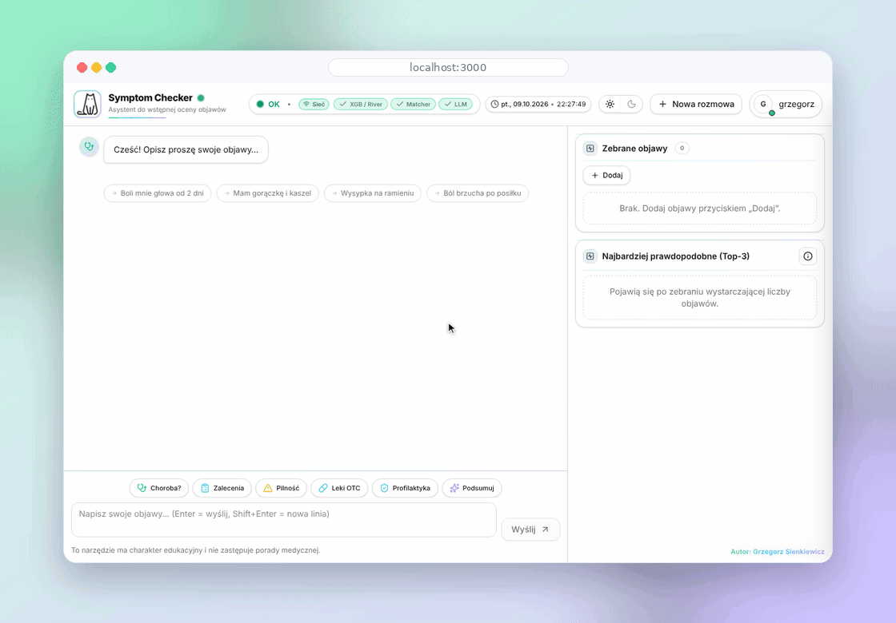
      <p align="center"><b>Panel objawów</b><br /><sub>Szukanie po nazwie lub synonimie, ręczne dodawanie objawów i Top-3 aktualizowane na bieżąco.</sub></p>
    </td>
    <td width="50%" valign="top">
      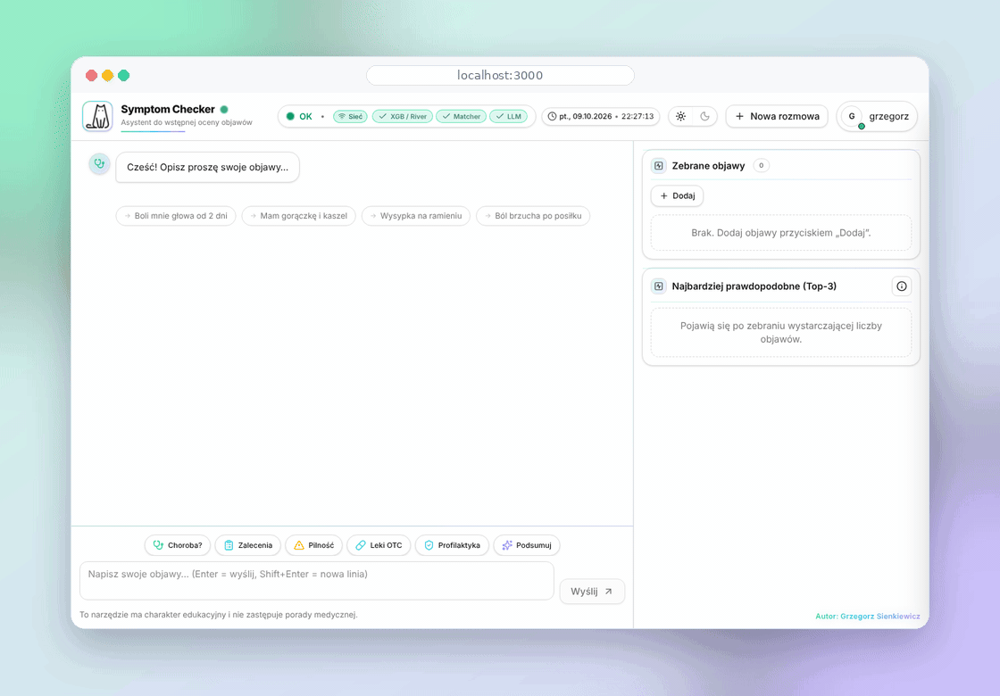
      <p align="center"><b>Historia rozmów</b><br /><sub>Wyszukiwanie zapisanych rozmów i podgląd objawów, diagnoz oraz wiadomości.</sub></p>
    </td>
  </tr>
  <tr>
    <td width="50%" valign="top">
      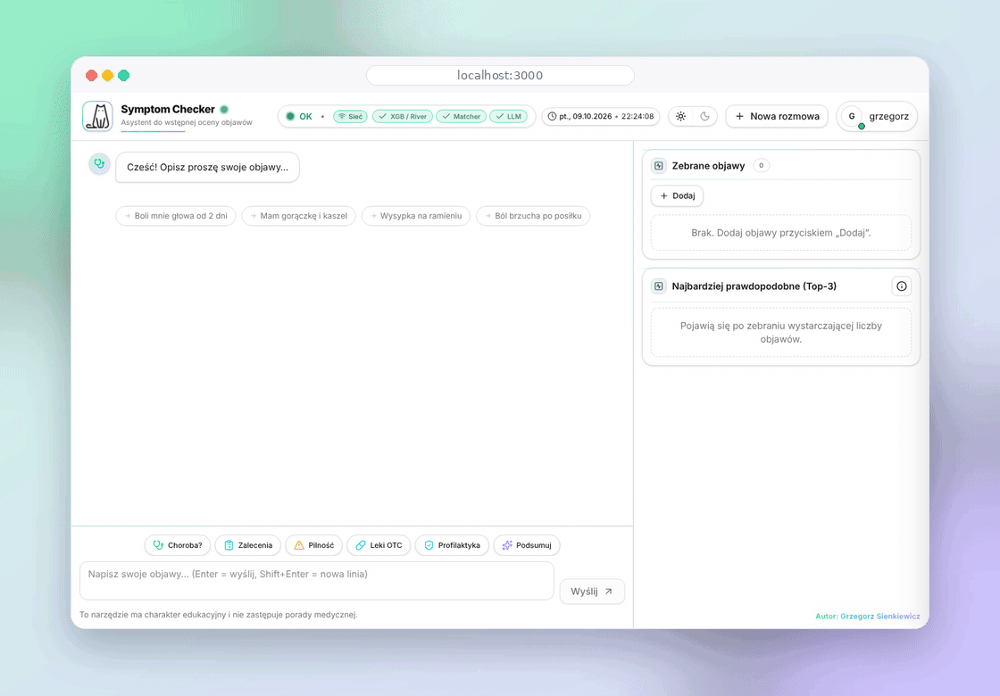
      <p align="center"><b>Przygotowanie do wizyty</b><br /><sub>Objawy, nasilenie i czas trwania; aplikacja pisze opis do skopiowania dla lekarza.</sub></p>
    </td>
    <td width="50%" valign="top">
      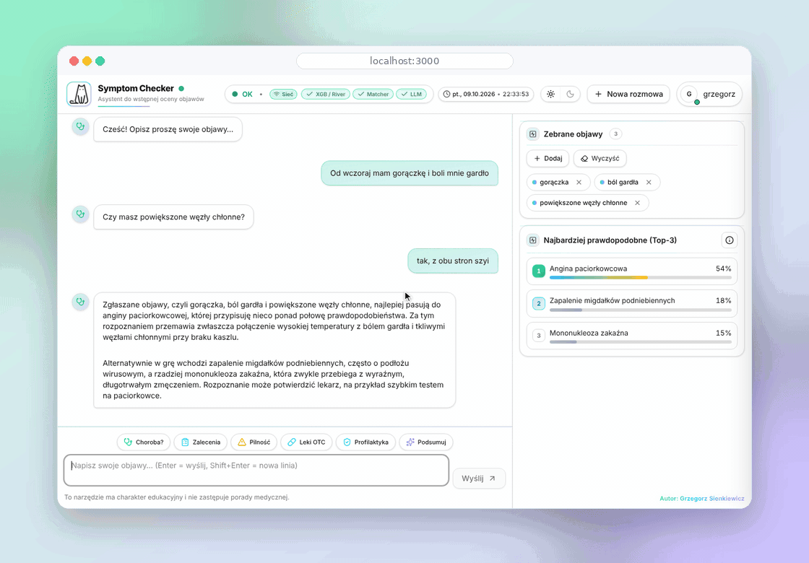
      <p align="center"><b>Ciemny motyw i przewodnik</b><br /><sub>Zmiana motywu jednym kliknięciem i wbudowany przewodnik.</sub></p>
    </td>
  </tr>
  <tr>
    <td width="50%" valign="top">
      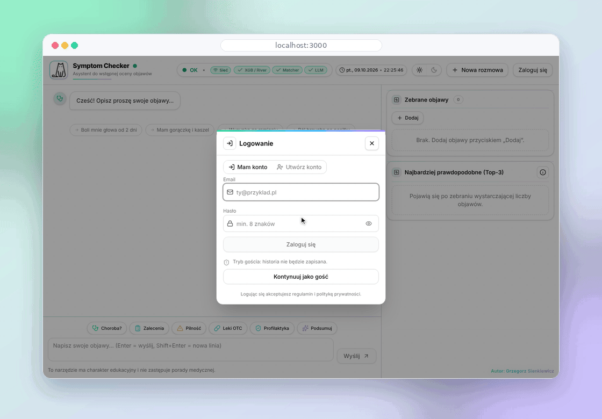
      <p align="center"><b>Logowanie i rejestracja</b><br /><sub>Logowanie przez Supabase albo zakładanie konta w tym samym panelu.</sub></p>
    </td>
    <td width="50%" valign="top">
      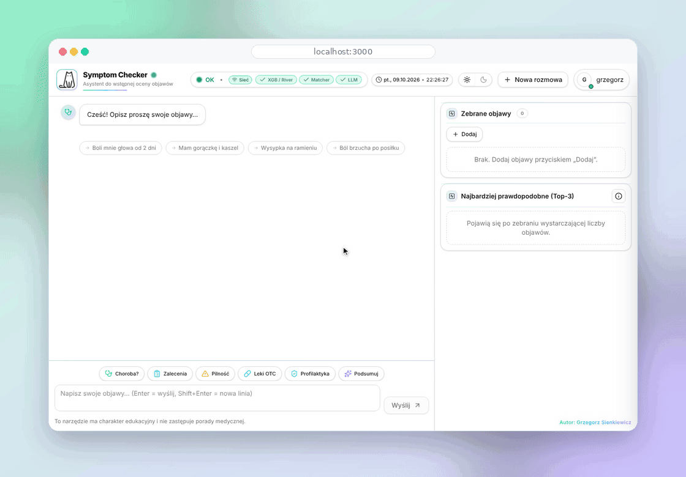
      <p align="center"><b>Konto i tryb gościa</b><br /><sub>Edycja profilu, wylogowanie i dalsza rozmowa jako gość.</sub></p>
    </td>
  </tr>
</table>

<sub>Zrzuty ekranu i animacje pochodzą z prawdziwego frontendu; odpowiedzi backendu są w nich zaskryptowane, żeby przykłady dało się powtórzyć.</sub>

## Jak to działa

<picture>
  <source media="(prefers-color-scheme: dark)" srcset="docs/ensemble-dark-pl.svg" />
  <source media="(prefers-color-scheme: light)" srcset="docs/ensemble-light-pl.svg" />
  
</picture>

### Jedna tura rozmowy

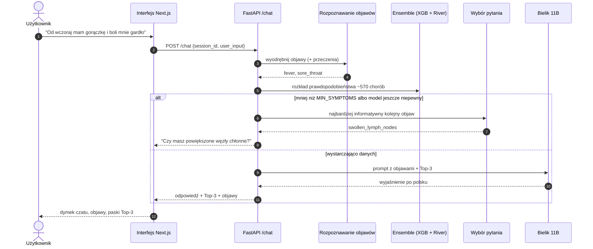

### Architektura

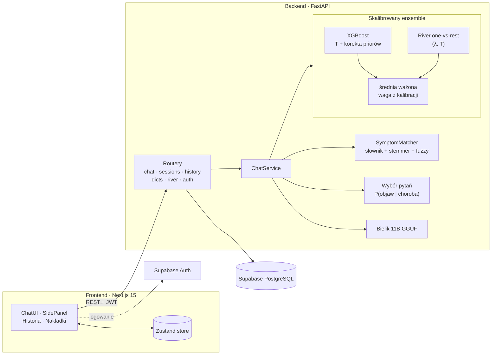

### Pipeline treningu (pierwsze uruchomienie)

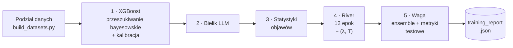

Każdy etap loguje czas, który minął, i czas do końca, więc długie pierwsze uruchomienie nie jest czarną skrzynką ([więcej](#postęp-i-pozostały-czas)):

<p align="center">
  
</p>

### Wyniki

<picture>
  <source media="(prefers-color-scheme: dark)" srcset="docs/results-dark-pl.svg" />
  <source media="(prefers-color-scheme: light)" srcset="docs/results-light-pl.svg" />
  
</picture>

Odłożony zbiór testowy: **24 278 przypadków, 569 chorób**, żaden wektor objawów nie powtarza się w danych treningowych ani kalibracyjnych. Liczby pochodzą z `backend/ml_validation_runner.py` (raport w `backend/reports/ml_validation/`).

| Model | Top-1 | Top-3 | NLL | ECE | Brier |
|---|:---:|:---:|:---:|:---:|:---:|
| XGBoost | 90,7% | 98,5% | 0,235 | 2,0% | 0,122 |
| River | 90,6% | 98,4% | 0,242 | 1,8% | 0,124 |
| **Ensemble** | **91,0%** | **98,6%** | **0,217** | **1,3%** | **0,113** |

- Właściwa choroba jest wśród trzech pokazanych w **98,6%** przypadków.
- Ensemble jest lepszy od obu modeli w każdej metryce. W Top-1 poprawia 369 przypadków, w których XGBoost się myli, a psuje 288 (dokładny test McNemara, **p = 0,002**).
- Kalibracja ma znaczenie: surowe wyniki one-vs-rest modelu River wskazywały około 75% pewności, gdy model miał rację w 91% przypadków (ECE 15,7% na zbiorze kalibracyjnym); po kalibracji ECE na zbiorze testowym wynosi 1,8%.

<details>
<summary><b>Kryteria walidacji</b> (wynik: <b>zaliczone</b>)</summary>
<br />

`python ml_validation_runner.py` porównuje ensemble z lepszym z dwóch modeli na tych samych przypadkach testowych:

| Kryterium | Wymaganie | Wynik |
|---|---|:---:|
| K1 | Top-1 istotnie lepsze (dokładny test McNemara, p < 0,05) | ✓ p = 0,0018 |
| K2 | Top-3 istotnie lepsze (dokładny test McNemara, p < 0,05) | ✗ p = 0,14 |
| K3 | Nie więcej błędów niż którykolwiek z modeli | ✓ |
| K4 | ECE nie gorsze niż gorszego modelu | ✓ 1,3% |
| Brak regresji | Żadna klasa nie traci istotnie >10 p.p. (test McNemara per klasa, poprawka Holma) | ✓ 0 klas |

Zaliczone = co najmniej 2 z K1 do K3 i brak regresji. K1/K2 pierwotnie wymagały rozłącznych 95% przedziałów bootstrapowych, a sprawdzenie per klasa nie miało testu istotności; oba zastąpiono testami sparowanymi, bo modele są oceniane na tych samych przypadkach (stare wartości nadal są wypisywane dla porównania).

</details>

<sub>NLL = ujemna log-wiarygodność, ECE = oczekiwany błąd kalibracji (10 przedziałów), Brier = wieloklasowy wynik Briera. Mniej znaczy lepiej.</sub>

## Stos technologiczny

| Warstwa | Technologia |
|-------|-----------|
| Backend | Python 3.11+, FastAPI, Pydantic v2, SQLAlchemy 2.x |
| Frontend | Next.js 15 (App Router), React 19, TypeScript, Tailwind CSS, Zustand |
| Klasyczne ML | XGBoost (`hist`, CUDA), scikit-learn, scikit-optimize |
| Uczenie online | River 0.23 (OneVsRest LogisticRegression; start z mini-batchy, potem SGD online) |
| LLM | Bielik 11B v2.3 Instruct (GGUF Q6_K) przez `ctransformers` |
| GPU | PyTorch (wykrywanie urządzenia CUDA), CUDA do treningu XGBoost i przenoszenia warstw LLM na GPU |
| Rozpoznawanie objawów | Słownik PL + synonimy, lekki stemmer języka polskiego, dopasowanie przybliżone (rapidfuzz albo difflib) |
| Logowanie | Supabase JWT (HS256; tylko `aud`/`role` = `authenticated`), ciasteczko sesji backendu, python-jose |
| Dane | Supabase PostgreSQL przez SQLAlchemy (psycopg 3) |
| Testy | pytest, pytest-asyncio, vitest, Playwright |

## Struktura projektu

```
SymptomChecker/
├── backend/
│   ├── api/routers/          # auth, chat, dicts, history, river, sessions, errors, health
│   ├── core/                 # start aplikacji, AppState
│   ├── data/                 # słowniki PL/EN, mały zbiór testowy (duże CSV w .gitignore)
│   ├── ml/                   # river_ovr_ftrl.joblib (w repo); xgb_model.joblib (poza repo)
│   ├── models/               # llm_manager, river_manager, xgb_manager
│   ├── reports/              # wyniki walidacji ML (SVG, JSON)
│   ├── services/             # ensemble, prompt_builder, symptom_matcher, sesje, …
│   ├── tests/                # pytest
│   ├── tools/                # export_predictions.py, simulate_followups.py (benchmark pytań uzupełniających)
│   ├── weights/bielik-gguf/  # ⬅ tu wrzuć plik GGUF Bielika (w .gitignore)
│   ├── config.py             # WSZYSTKIE ustawienia ML / LLM / logowania
│   ├── app.py                # fabryka FastAPI
│   ├── main.py               # punkt startowy uvicorn
│   ├── ml_validation_runner.py
│   └── requirements.txt
├── database/                 # SQLAlchemy: modele, CRUD, bezpieczeństwo, inicjalizacja bazy
├── docs/                     # grafiki do README: animowane SVG, demo.gif, gifs/, screenshots/, icons/
├── frontend/
│   ├── .env.example          # zmienne środowiskowe frontendu (skopiuj do .env.local)
│   ├── public/               # logo
│   └── src/
│       ├── app/              # strony Next.js App Router
│       ├── components/       # ChatUI, AuthSheet, SidePanel, …
│       ├── lib/              # api, supabaseClient, typy
│       ├── store/            # store Zustand
│       └── tests/            # testy jednostkowe + e2e
├── .github/workflows/ci.yml  # CI: pytest, ESLint, vitest, tsc, next build
├── logs/
├── .env.example              # zmienne środowiskowe backendu (skopiuj do .env)
├── .gitignore
├── FUTURE_PLANS.md           # zaplanowane rozszerzenia (wersja angielska)
├── LICENSE
├── README.md                 # README po angielsku
└── README.pl.md              # README po polsku
```

## Uruchomienie

### Wymagania

- **Python 3.11** lub nowszy
- **Node.js 18.18+** i npm (wymagane przez Next.js 15)
- **Karta graficzna z CUDA** mocno zalecana (szybki trening XGBoost i działanie LLM). Na CPU też działa, ale znacznie wolniej.
- **~20 GB wolnego miejsca** (wagi LLM ~9,2 GB, środowisko Pythona z PyTorchem, model XGBoost ~590 MB, zbiory danych ~500 MB)
- **Projekt Supabase**, wymagany przez backend: Postgres na historię (`DATABASE_URL`, pooled) i Auth (`SUPABASE_JWT_SECRET`). W interfejsie można rozmawiać jako gość bez logowania

### Backend

```bash
# w katalogu głównym repozytorium
python -m venv .venv
.\.venv\Scripts\Activate.ps1      # Windows (PowerShell)
source .venv/bin/activate        # Linux / macOS

pip install -r backend/requirements.txt
cp .env.example .env             # Windows: Copy-Item .env.example .env
```

Uzupełnij `.env` (katalog główny repozytorium, wczytywany przez `backend/main.py`): `DATABASE_URL` (adres Postgresa Supabase w trybie pooled), `SUPABASE_URL`, `SUPABASE_JWT_SECRET` i `FRONTEND_ORIGIN`. Bez `DATABASE_URL` backend nie wystartuje, a bez `SUPABASE_JWT_SECRET` nie działa logowanie przez Supabase.

### Pliki spoza repozytorium

Te pliki nie są w repozytorium ze względu na rozmiar, trzeba je dostarczyć samodzielnie.

#### Wagi LLM: Bielik 11B GGUF

Pobierz `Bielik-11B-v2.3-Instruct.Q6_K.gguf` (~9,2 GB) z HuggingFace:

🔗 https://huggingface.co/speakleash/Bielik-11B-v2.3-Instruct-GGUF

Umieść go w:

```
backend/weights/bielik-gguf/Bielik-11B-v2.3-Instruct.Q6_K.gguf
```

Inne kwantyzacje (Q4_K_M, Q5_K_M) też działają, wystarczy zmienić `LLM_SLOTS["bielik"]["FILENAME"]` w `backend/config.py`.

#### Zbiory treningowe

Duże pliki treningowe **nie są przechowywane w tym repozytorium** ze względu na rozmiar. Oba zbiory źródłowe są publiczne (zobacz [Źródła danych](#źródła-danych)), więc możesz je pobrać i samodzielnie odtworzyć podziały. Jeśli potrzebujesz dokładnie tych podziałów, których użyto w pracy (do recenzji akademickiej albo odtworzenia wyników), skontaktuj się z autorem (zobacz [Kontakt](#kontakt)).

Aplikacja oczekuje następujących plików w ścieżkach zdefiniowanych w `backend/config.py`:

| Ścieżka | Rola | Przybliżony rozmiar |
|------|------|--------------|
| `backend/data/train_remainder.csv` | Podział źródłowy, wejście do `build_datasets.py` | ~100 MB |
| `backend/data/calibration.csv` | Podział źródłowy, wejście do `build_datasets.py` | ~30 MB |
| `backend/data/Final_Testset_for_Eval.csv` | Podział źródłowy (w repo), wejście do `build_datasets.py` | ~14 MB |
| `backend/data/Final_Dataset_Diseases_and_Symptoms.csv` | Pełny oryginalny zbiór; zapasowe dane treningowe, gdy nie ma innego podziału | ~130 MB |
| `backend/data/Final_Dataset_Diseases_and_Symptoms.class_weight.csv` | Wagi klas dla zbioru zapasowego (w repo) | ~30 KB |
| `backend/data/v2/train.csv` / `calibration.csv` / `test.csv` | **Tego używają modele**, generowane przez `build_datasets.py` | ~92 / 20 / 20 MB |

**Zalecane: zbuduj podziały raz** poleceniem `python data/build_datasets.py` (uruchom w `backend/`). Skrypt zapisuje `backend/data/v2/` (`train.csv`, `calibration.csv`, `test.csv`, `class_weight.csv`, `build_report.json`), z którego `config.py` korzysta automatycznie, jeśli katalog istnieje. Przebudowa naprawia problemy znalezione w oryginalnych plikach:

- każdy wiersz `Final_Testset_for_Eval.csv` występował też w `train_remainder.csv` albo `calibration.csv` (metryki testowe były zawyżone); nowe podziały nie mają wspólnych wektorów objawów,
- zduplikowane etykiety tej samej choroby z drugiego zbioru źródłowego (np. `bronchial_asthma`/`asthma`, `dengue`/`dengue_fever`) są scalane,
- choroby z mniej niż 10 przykładami są usuwane (`--min-rows`),
- wagi klas to `sqrt(N / (K * n_c))` przycięte do `[0.5, 5]` zamiast dochodzić do ~200.

Po przebudowie usuń stare artefakty modeli (zobacz [Co się dzieje przy pierwszym starcie](#co-się-dzieje-przy-pierwszym-starcie)), żeby modele wytrenowały się na nowych danych.

Jeśli chcesz użyć **własnego zbioru danych**, zajrzyj do sekcji [Format danych](#format-danych) poniżej. Jeśli Twoje pliki CSV mają oczekiwany schemat, pipeline wytrenuje, skalibruje i oceni modele bez zmian w kodzie.

### Frontend

```bash
cd frontend
npm install
cp .env.example .env.local       # Windows: Copy-Item .env.example .env.local
```

Uzupełnij `frontend/.env.local`: `NEXT_PUBLIC_SUPABASE_URL`, `NEXT_PUBLIC_SUPABASE_ANON_KEY` i `NEXT_PUBLIC_API_BASE_URL` (domyślnie `http://localhost:8000`).

### Start

```bash
# Terminal 1: backend
cd backend
python main.py
# domyślnie: http://127.0.0.1:8000  (dokumentacja Swagger pod /docs)

# Terminal 2: frontend
cd frontend
npm run dev
# http://localhost:3000
```

## Pierwsze uruchomienie: trening modeli

Przy pierwszym starcie backendu **system trenuje modele ML od zera** na Twoich danych. Kolejne uruchomienia korzystają z zapisanych artefaktów i startują w kilka sekund.

### Co się dzieje przy pierwszym starcie

`StartupManager` sprawdza, czy istnieją:

- `backend/ml/xgb_model.joblib`: główny klasyfikator XGBoost
- `backend/ml/label_encoder.joblib`: koder etykiet chorób
- `backend/ml/xgb_best_params.joblib`: hiperparametry z optymalizacji bayesowskiej
- `backend/ml/river_ovr_ftrl.joblib`: model River one-vs-rest (jest w repozytorium)
- `backend/ml/river_ovr_ftrl.calibration.joblib`: kalibrator temperatury dla River

Jeśli brakuje któregoś z artefaktów XGB, uruchamia się cały pipeline:

1. **Wczytanie danych treningowych** z `DATA_CSV` (domyślnie `data/v2/train.csv`, jeśli istnieje, zobacz [Zbiory treningowe](#zbiory-treningowe))
2. **Bayesowskie przeszukiwanie hiperparametrów**: `XGB_N_ITER_BAYES` × `XGB_CV_SPLITS`-krotna walidacja krzyżowa (domyślnie 32 × 3 = 96 treningów)
3. **Trening końcowy** na zbiorze treningowym z najlepszymi parametrami
4. **Kalibracja temperaturą** na odłożonych danych, których model nigdy nie widział (`calibration.csv`; jeśli go brakuje, odkładana jest warstwowa próbka ze zbioru treningowego *przed* treningiem)
5. **Zapis artefaktów** do `backend/ml/` (plus `xgb_model.meta.json` z informacją, na jakich danych model był trenowany)

> Żeby wytrenować wszystko od nowa, usuń `backend/ml/xgb_model.joblib`, `label_encoder.joblib`, `xgb_best_params.joblib`, `xgb_model.calibration.joblib`, `river_ovr_ftrl.joblib`, `river_ovr_ftrl.calibration.joblib` i `ensemble_calibration.json`. Modele wytrenowane przez starsze wersje nadal się wczytują, ale backend loguje ostrzeżenie.

Potem każdy kolejny start tylko **wczytuje zapisane modele** (~5-10 s).

### Postęp i pozostały czas

Każdy długi krok loguje postęp z czasem, który minął, i szacowanym czasem do końca (przykład w sekcji [Jak to działa](#pipeline-treningu-pierwsze-uruchomienie)).

Start jest podzielony na etapy `[ETAP 1/5]` (XGB) ... `[ETAP 5/5]` (kalibracja ensemble), każdy z czasem trwania, a na końcu logowany jest czas całkowity. River zaczyna od 12 epok treningu w mini-batchach (Adam, numpy) na zbiorze treningowym, a potem uczy się dalej online; pojedyncze przejście online (`RIVER_BOOTSTRAP_MODE=online`) zostawiało go wyraźnie niedotrenowanym.

Pomiary na komputerze autora (GPU z CUDA): przeszukiwanie bayesowskie ~19,5 h, końcowy trening XGBoost 11 min, River około 1 min, kalibracja ensemble i raport 1,5 min. Przeszukiwanie wykonuje się tylko raz; wynik zapisywany jest w `xgb_best_params.joblib`.

### Kalibracja i raport jakości

Wszystkie trzy predyktory są kalibrowane na `calibration.csv` (niewidzianym w treningu) i mierzone na `test.csv`:

- **XGBoost**: `p = softmax((margins - log w_c) / T)`. `T` dobierane jest przez minimalizację NLL. Korekta priorów wag klas `log w_c` (trening z wagami klas zawyża rzadkie klasy) jest używana tylko wtedy, gdy obniża NLL na zbiorze kalibracyjnym.
- **River (regresja logistyczna one-vs-rest)**: `p = softmax((z - lam * z_base) / T)`, gdzie `z` to surowe logity dla każdej klasy, a `z_base` to logity dla pustego wejścia; `(lam, T)` są dobierane razem i ta sama transformacja jest używana przy predykcji.
- **Ensemble**: `p = a * p_xgb + (1 - a) * p_river`, gdzie `a` dobierane jest przez minimalizację NLL na zbiorze kalibracyjnym (`ENSEMBLE_FUSION=linear`; nadal dostępne są `log` i stary tryb `heuristic`). Wynik jest zapisywany w `backend/ml/ensemble_calibration.json` i przeliczany tylko po zmianie modelu.

Metryki (top-1, top-3, NLL, ECE, Brier, średnia pewność) przed kalibracją i po niej są logowane w tabelach i zapisywane do `backend/ml/training_report.json`.

### Ładowanie LLM

Bielik 11B Q6_K **nie jest trenowany**, tylko wczytywany do pamięci:

| Konfiguracja | Czas ładowania |
|-------|-----------|
| GPU + dysk NVMe SSD | ~30-90 s |
| CPU + NVMe | ~1-2 min |
| HDD | bardzo wolno, przenieś plik GGUF na SSD |

Po wczytaniu generowanie jest szybkie (kilka sekund na podsumowanie Top-3 na GPU).

## Format danych

<details>
<summary><b>Oczekiwany format plików CSV i słowników</b></summary>

Jeśli nie masz oryginalnych danych treningowych i chcesz użyć własnych, pliki CSV muszą mieć poniższy schemat. Wtedy cały pipeline treningu, kalibracji i oceny zadziała bez zmian w kodzie.

### 1. Główny CSV treningowy: `Final_Dataset_Diseases_and_Symptoms.csv`

**Szeroka binarna macierz cech** w formacie CSV. Jeden wiersz = jeden opisany przypadek pacjenta.

**Wymagane kolumny:**

| Kolumna | Typ | Opis |
|--------|------|-------------|
| `diseases` | string | Etykieta docelowa: nazwa choroby (np. `"Influenza"`). **Wymagana.** |
| `<symptom_name>` × N | int (0/1) | Jedna kolumna na objaw, obecność lub brak. Nazwy muszą odpowiadać **angielskim kluczom** w `backend/data/symptoms_pl_en.json`. |
| `weight` | float | *(Opcjonalna)* Waga próbki. Jeśli jej brak, brana jest z `class_weight.csv`; domyślnie `1.0`. |

**Zarezerwowane nazwy kolumn** (nie używaj ich jako cech): `diseases`, `xgb_label`, `weight`.

**Przykład:**

```csv
diseases,fever,cough,headache,nausea,fatigue,sore_throat,chest_pain,...
Influenza,1,1,1,0,1,1,0,...
COVID-19,1,1,0,1,1,1,0,...
Migraine,0,0,1,1,1,0,0,...
Common Cold,0,1,1,0,1,1,0,...
Pneumonia,1,1,0,0,1,0,1,...
```

**Uwagi:**
- Wiersze z `NaN` są automatycznie pomijane.
- W nazwach kolumn objawów **liczy się wielkość liter** i muszą dokładnie odpowiadać kluczom słownika.
- Klasyfikator używa wewnętrznie `uint8` 0/1; napisy i liczby zmiennoprzecinkowe zostaną przekonwertowane albo odrzucone.
- Każda choroba powinna mieć **co najmniej 3 próbki** do warstwowej 3-krotnej walidacji krzyżowej; klasy z mniejszą liczbą próbek trafiają do treningu końcowego, ale są pomijane przy przeszukiwaniu hiperparametrów.

### 2. CSV z wagami klas: `Final_Dataset_Diseases_and_Symptoms.class_weight.csv`

Używany awaryjnie do uzupełnienia `weight`, gdy główny CSV jej nie zawiera. Jest już w repozytorium, ale można go wygenerować z własnego zbioru.

| Kolumna | Typ | Opis |
|--------|------|-------------|
| `disease` | string | Nazwa choroby (musi odpowiadać wartościom kolumny `diseases` w głównym CSV) |
| `count` | int | Liczba próbek tej choroby |
| `class_weight` | float | Mnożnik wagi dla próbek tej klasy |

**Przykład:**

```csv
disease,count,class_weight
Influenza,1850,1.0
COVID-19,2100,0.88
Migraine,420,4.4
Pneumonia,950,1.95
```

### 3. CSV kalibracyjny: `calibration.csv`

Ten sam schemat co główny CSV treningowy. Odłożona część danych (zwykle 5-10% danych treningowych, warstwowo według choroby) używana przez kalibrator temperatury River. Kolumna `weight` jest tu opcjonalna.

### 4. CSV testowy: `Final_Testset_for_Eval.csv`

Ten sam schemat co główny CSV treningowy. Używany przez `ml_validation_runner` do pełnej oceny. **Jest już w repozytorium.**

### 5. Słownik objawów: `symptoms_pl_en.json`

Lista wpisów mapujących polskie nazwy objawów (i synonimy) na kolumny cech. Jest już w repozytorium. Format:

```json
[
  {
    "en": "Sore throat",
    "pl": "ból gardła",
    "xgb_label": ["sore_throat"],
    "synonyms_pl": ["drapanie w gardle", "ból przy przełykaniu"],
    "synonyms_en": [],
    "category": "Otolaryngologiczny"
  }
]
```

`xgb_label` musi odpowiadać nazwom kolumn CSV. Gdy wskazuje kilka kolumn, rozpoznawanie objawów wybiera tę z największą liczbą danych treningowych i pomija kolumny, które nie występują w zbiorze treningowym (`build_datasets.py` zgłasza wpisy słownika bez danych).

### 6. Słownik chorób: `diseases_pl_en.json`

Ta sama idea dla chorób; służy do pokazywania polskich nazw w interfejsie i w promptach dla LLM:

```json
[
  { "en": "Strep throat", "pl": "Angina paciorkowcowa", "xgb_label": "strep_throat" }
]
```

</details>

## Endpointy API

<details>
<summary><b>Wszystkie endpointy</b></summary>

### Czat
| Metoda | Endpoint | Opis |
|--------|----------|-------------|
| `POST` | `/chat` | Główne wejście: wysyła wiadomość użytkownika, zwraca rozpoznane objawy + Top-3 diagnoz + podsumowanie LLM |

### Logowanie
| Metoda | Endpoint | Opis |
|--------|----------|-------------|
| `POST` | `/auth/session` | Tworzy sesję na podstawie tokenu JWT z Supabase |
| `GET` | `/auth/me` | Profil zalogowanego użytkownika |
| `PUT` | `/auth/me` | Aktualizacja profilu |
| `POST` | `/auth/logout` | Zakończenie sesji |

### Sesje (stan rozmowy)
| Metoda | Endpoint | Opis |
|--------|----------|-------------|
| `POST` | `/sessions/{session_id}/symptoms` | Zmiana zestawu objawów w sesji |
| `GET` | `/sessions/{session_id}/top3-split` | Top-3 z podziałem na modele (XGB i River) |

### Historia
| Metoda | Endpoint | Opis |
|--------|----------|-------------|
| `GET` | `/history` | Lista rozmów użytkownika |
| `GET` | `/history/{conv_id}` | Szczegóły rozmowy (wiadomości, rozpoznane objawy, ocena pilności) |
| `DELETE` | `/history/{conv_id}` | Usunięcie rozmowy |

### Słowniki
| Metoda | Endpoint | Opis |
|--------|----------|-------------|
| `GET` | `/dicts/symptoms` | Pełny słownik objawów PL/EN |

### River (uczenie online)

Endpointy do odczytu (`status`, `features`, `predict_topk`) są otwarte. Endpointy, które zmieniają model albo czytają pliki CSV, wymagają nagłówka `X-Admin-Token` zgodnego z `ADMIN_API_TOKEN` (gdy zmienna jest pusta, są wyłączone) i przyjmują tylko pliki `.csv` z `backend/data/`. Działają na tym samym modelu River, którego używa ensemble w czacie.

| Metoda | Endpoint | Opis |
|--------|----------|-------------|
| `GET` | `/river/status` | Stan modelu, liczba próbek, stan kalibracji |
| `GET` | `/river/features` | Aktualna lista cech River |
| `POST` | `/river/predict_topk` | Predykcja z wektora cech |
| `POST` | `/river/train_one` | Aktualizacja online jedną próbką (admin) |
| `POST` | `/river/incremental_batch` | Aktualizacja online mini-batchem (admin) |
| `POST` | `/river/fit_from_csv` | Douczenie z pliku CSV w `backend/data/` (admin) |
| `GET` | `/river/evaluate` | Ocena na zbiorze testowym (admin) |

### Stan usługi
| Metoda | Endpoint | Opis |
|--------|----------|-------------|
| `GET` | `/health` | Sprawdzenie, czy backend działa |

Pełna dokumentacja Swagger jest pod `http://127.0.0.1:8000/docs` po uruchomieniu backendu.

</details>

## Konfiguracja

<details>
<summary><b>Wszystkie ustawienia</b></summary>

Wszystkie ustawienia ML / LLM / logowania są w **`backend/config.py`**. Nadpisania w czasie działania pochodzą z `.env`. Poniżej najważniejsze ustawienia, pełna lista jest w samym pliku.

### Środowisko

| Ustawienie | Źródło | Domyślnie | Znaczenie |
|---------|--------|---------|---------|
| `APP_ENV` | env | `dev` | `dev` albo `prod` |
| `HOST` / `PORT` | env | `127.0.0.1` / `8000` | adres uvicorn |
| `FRONTEND_ORIGIN` | env | `http://localhost:3000` | origin dla CORS |
| `LOG_LEVEL` | env | `INFO` | poziom logowania |

### Logowanie i sesje

| Ustawienie | Źródło | Domyślnie | Znaczenie |
|---------|--------|---------|---------|
| `DATABASE_URL` | env | - | **Wymagane.** Adres Postgresa Supabase w trybie pooled (`postgresql+psycopg://…supabase.com…`) |
| `SUPABASE_URL` | env | - | Adres projektu Supabase (tylko w komunikacie startowym; tokeny są weryfikowane przez `SUPABASE_JWT_SECRET`) |
| `SUPABASE_JWT_SECRET` | env | - | **Wymagane** do logowania: sekret HS256 JWT z Supabase (Project Settings → API). Bez `AUTH_SECRET_KEY` podpisuje też ciasteczko sesji backendu |
| `AUTH_SECRET_KEY` | env | `SUPABASE_JWT_SECRET` | Sekret do tokenów sesji backendu |
| `ACCESS_TOKEN_EXPIRE_MINUTES` | env | `60` | Czas życia JWT |
| `SESSION_COOKIE_SECURE` / `SESSION_COOKIE_SAMESITE` | env | `false` / `lax` | ustaw `true` / `none` dla HTTPS między domenami |
| `ADMIN_API_TOKEN` | env | puste | Token do endpointów admina `/river/*` (puste = wyłączone) |

### Trening XGBoost

| Ustawienie | Domyślnie | Efekt |
|---------|---------|--------|
| `XGB_N_ITER_BAYES` | `32` | Liczba iteracji przeszukiwania bayesowskiego. **Mniej = szybsze pierwsze uruchomienie, nieco słabszy model.** Do developmentu spróbuj `8-16` |
| `XGB_CV_SPLITS` | `3` | Liczba podziałów walidacji krzyżowej |
| `XGB_USE_GPU` | `True` | Użycie CUDA |
| `XGB_TREE_METHOD` | `"hist"` | Najszybszy algorytm budowy drzew |
| `XGB_CALIBRATE` | `True` | Skalowanie temperaturą (dobierane na odłożonych danych) |
| `XGB_CALIBRATION_CSV` | `data/v2/calibration.csv` (jeśli istnieje v2) | Odłożony zbiór kalibracyjny (musi być inny niż `DATA_CSV`) |

### River

| Ustawienie | Domyślnie | Znaczenie |
|---------|---------|---------|
| `RIVER_CALIBRATE_ON_START` | `True` | Ponowna kalibracja przy każdym starcie |
| `RIVER_BOOTSTRAP_MODE` | `batch` | `batch` = start z mini-batchy (zalecane), `online` = stare pojedyncze przejście FTRL |
| `RIVER_BATCH_EPOCHS` / `RIVER_BATCH_LR` / `RIVER_BATCH_L2` | `12` / `0.02` / `1e-5` | Trening w mini-batchach (Adam) |
| `RIVER_ONLINE_LR` | `0.01` | Krok uczenia SGD przy aktualizacjach online po starcie |
| `RIVER_ALPHA` | `0.1` | Krok uczenia FTRL (tylko tryb `online`) |
| `RIVER_L1` / `RIVER_L2` | `1e-6` / `1e-4` | Regularyzacja |
| `RIVER_WEIGHT_CAP` | `25.0` | Maksymalna waga klasy |

### Ensemble

| Ustawienie | Domyślnie | Znaczenie |
|---------|---------|---------|
| `ENSEMBLE_FUSION` | `linear` | `linear` / `log` z wagą dobraną na zbiorze kalibracyjnym albo stary `heuristic` |
| `ENSEMBLE_W_XGB` / `ENSEMBLE_W_RIVER` | `0.8` / `0.2` | Wagi bazowe (tylko `heuristic`) |
| `ENSEMBLE_K_FUSE` | `0` | `0` = łączenie pełnych rozkładów (zalecane); `>0` = tylko Top-K z każdego modelu |
| `ENSEMBLE_MIN_XGB_WEIGHT` / `ENSEMBLE_MIN_RIVER_WEIGHT` | `0.55` / `0.15` | Minimalny udział każdego modelu |
| `ENSEMBLE_CONF_GAP` | `0.20` | Gdy jeden model jest pewniejszy o tyle, dostaje maksymalny dozwolony udział |

### Generowanie LLM

| Ustawienie | Domyślnie | Znaczenie |
|---------|---------|---------|
| `LLM_MAX_NEW_TOKENS` | `2000` | Maksymalna liczba generowanych tokenów |
| `LLM_TEMP` | `0.72` | Temperatura próbkowania |
| `LLM_TOP_P` / `LLM_TOP_K` | `0.92` / `40` | Próbkowanie nucleus / top-k |
| `LLM_CONTEXT_LEN` | `8192` | Okno kontekstu |
| `LLM_GPU_LAYERS` | `999` | Liczba warstw na GPU (`999` = wszystkie) |

### Przebieg rozmowy

| Ustawienie | Domyślnie | Znaczenie |
|---------|---------|---------|
| `MIN_SYMPTOMS` | `3` | Minimalna liczba objawów przed oceną |
| `STOP_FOLLOWUPS_AT` | `5` | Maksymalna liczba pytań uzupełniających w sesji; potem podawana jest ocena (orientacyjna, z zastrzeżeniem, jeśli objawów jest mniej niż `MIN_SYMPTOMS`) |
| `FOLLOWUP_CONFIDENCE` | `0.7` | Przy co najmniej `MIN_SYMPTOMS` objawach pytania trwają, aż prawdopodobieństwo Top-1 osiągnie ten poziom (progi dobrane narzędziem `tools/simulate_followups.py`) |
| `TOPN_DIAGNOSES` | `3` | Liczba zwracanych diagnoz |
| `SUMMARY_MODE` | `"llm"` | `"llm"` albo `"template"` |

</details>

## Źródła danych

| Zbiór | Autor i licencja | Zastosowanie | W repozytorium |
|---|---|---|---|
| [Disease and symptoms dataset 2023](https://data.mendeley.com/datasets/2cxccsxydc/1) | Stark, Bran (2025), Mendeley Data, V1, doi:10.17632/2cxccsxydc.1. **CC BY 4.0** | Główne źródło danych treningowych, kalibracyjnych i testowych | `backend/data/Final_Testset_for_Eval.csv` i pliki z niego wyprowadzone |
| [Disease Prediction Based on Symptoms](https://www.kaggle.com/datasets/noeyislearning/disease-prediction-based-on-symptoms) | Francis (użytkownik Kaggle noeyislearning). **CC0: Public Domain** | Dodatkowe choroby dołączone do głównego zbioru | `backend/data/Dataset_2/` |

Zmiany w danych: wiersze zostały oczyszczone, zduplikowane etykiety chorób z obu źródeł scalone, rzadkie choroby usunięte, a dane podzielone na nowo bez nakładania się zbiorów (`backend/data/build_datasets.py`, zobacz [Zbiory treningowe](#zbiory-treningowe)). Polskie nazwy objawów i chorób w `backend/data/*_pl_en.json` są pracą własną autora.

Autor zbioru Mendeley opisuje go jako wygenerowany sztucznie (z zachowaniem nasilenia objawów i prawdopodobieństwa występowania chorób). Wyniki w tym README są zmierzone na tych danych i nie opisują trafności klinicznej na prawdziwych pacjentach.

## Licencja

**Copyright © 2026 Grzegorz Sienkiewicz. Wszelkie prawa zastrzeżone.**

Oprogramowanie powstało w ramach pracy inżynierskiej. Jest opublikowane na GitHubie **wyłącznie do recenzji akademickiej i jako portfolio**. Bez wcześniejszej pisemnej zgody autora nie udziela się licencji na używanie, kopiowanie, modyfikowanie, rozpowszechnianie, sublicencjonowanie ani komercyjne wykorzystanie kodu, w całości ani w części.

Jeśli chcesz użyć dowolnej części projektu (do cytowania w pracy naukowej, badań, oceny lub w innym celu), skontaktuj się z autorem (zobacz [Kontakt](#kontakt) poniżej). Każda prośba jest rozpatrywana indywidualnie.

Zależności open source innych firm podlegają własnym licencjom (zobacz `backend/requirements.txt` i `frontend/package.json`). Zbiory danych zachowują swoje oryginalne licencje (zobacz [Źródła danych](#źródła-danych)).

Pełne warunki są w pliku [LICENSE](LICENSE) (po angielsku).

## Kontakt

**Grzegorz Sienkiewicz**
✉️ gsienkiewicz03@gmail.com
🐙 GitHub: [@Nurek54](https://github.com/Nurek54)

W sprawie dostępu do zbiorów treningowych, licencji albo pytań o pracę inżynierską napisz e-mail.
